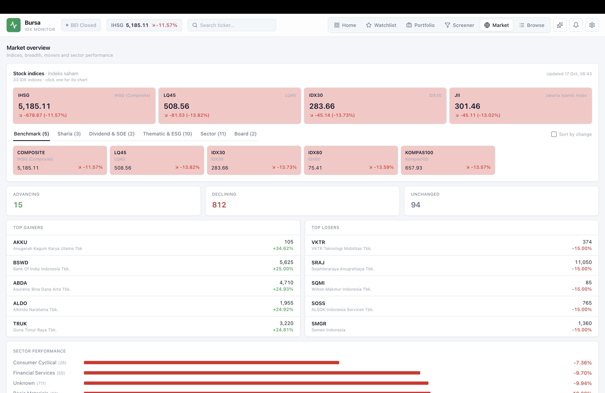

# Bursa

[](LICENSE)

A self-hosted stock monitor for the **Indonesia Stock Exchange (IDX / Bursa Efek Indonesia)**.

Track index constituents, watch your hand-picked stocks, follow your portfolio, and get
explainable buy signals from fundamentals and price data. Everything runs on your own machine with
Docker Compose, using free data sources.

Bursa is **free and open source** under the [MIT License](LICENSE).




## Highlights

- **Whole market**: all ~960 IDX stocks, 33 stock indices (IHSG, LQ45, IDX30, sector indices, …),
  breadth, top movers and a live market clock.
- **Explainable signals**: a factor score (Quality, Valuation, Growth, Momentum, Health) turned
  into Strong Buy → Avoid ratings with plain-language reasons. Pick an **Investor** or **Trader** style.
- **Screener, watchlist and charts**: filter by score, PBV, RoE and sector. Charts are candlestick or
  line, from intraday to decades of history, with indicators and an IHSG overlay.
- **Portfolio**: lot-based transactions, P/L, time-weighted return vs IHSG, risk view, dividend
  calendar, and a hide-values toggle for screen privacy.
- **Alerts**: price, %-change and rating-change rules, in-app or via Telegram.
- **AI assistant** (optional): ask questions about the market in English or Indonesian, answered
  from the app's own data (Gemini free tier).
- **Gentle on free APIs**: tiered sync, a rate-limit governor and the database as the cache.
- **Invite-only accounts**: everyone gets their own watchlist, portfolio, alerts and style;
  email + password sign-in, admin-managed invites and reset links.
- **Your choice of database**: SQLite out of the box; PostgreSQL or MySQL by changing one setting.

See the full **[feature list](docs/features.md)**.

## Quick start

```bash
docker compose up --build
```

Open **http://localhost:5173**. The API runs at http://localhost:8000 (docs at `/docs`).
Data is stored in `backend/data/bursa.db` and survives restarts.

Bursa is invite-only. Get the one-time link for the first (admin) account from the logs:

```bash
docker compose logs backend | grep "Create the admin"
```

To enable the AI assistant, email or Telegram alerts, copy `backend/.env.example` to
`backend/.env` and fill in the keys. See [Configuration](docs/configuration.md).

## Documentation

| | |
|---|---|
| [Getting started](docs/getting-started.md) | Docker, resetting data, hot-reload dev servers |
| [Features](docs/features.md) | Everything the app does, plus accessibility |
| [Configuration](docs/configuration.md) | Settings, `.env` keys, database, providers, AI assistant, Telegram |
| [Architecture](docs/architecture.md) | Project layout, database layer, data sync, caching, rate-limiting |
| [API reference](docs/api.md) | All REST endpoints |
| [Development](docs/development.md) | Lint, type check, tests, signal backtest |
| [Third-party notices](docs/third-party-notices.md) | Dependency licenses, attribution, data sources |

## Tech stack

Python 3.14 · FastAPI · SQLAlchemy (async) + Alembic · SQLite / PostgreSQL / MySQL · APScheduler · yfinance ·
React 19 · Vite · TypeScript · Tailwind CSS · TanStack Query · Lightweight Charts · Docker + nginx

## License

[MIT](LICENSE) © 2026 Lalu Haryadi Guni. You're free to use, modify and share it, for personal or
commercial use, as long as the copyright notice is kept. It comes without any warranty.

Charts use **TradingView Lightweight Charts™**, which requires attribution (shown in the app
footer). The license covers the code only: market data comes from Yahoo Finance and the IDX
website under their own terms. Bursa is not affiliated with them. Details are in
[third-party notices](docs/third-party-notices.md).

> **Not financial advice.** Signals and figures are heuristic estimates for personal reference.
> Do your own research before investing.
