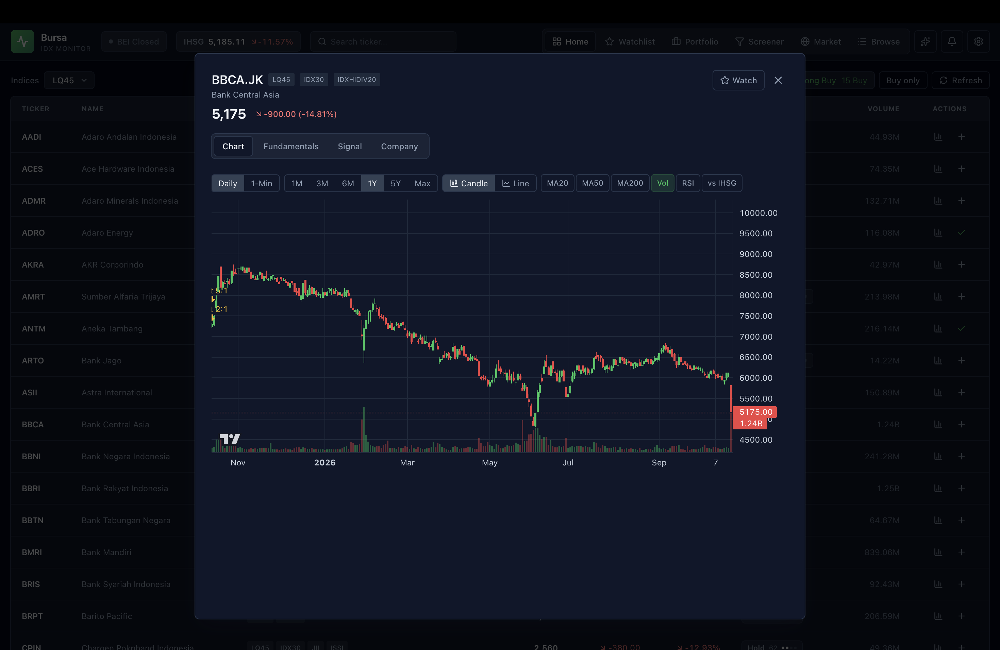

# Bursa

[](LICENSE)

A personal stock monitor for the **Indonesia Stock Exchange (IDX / Bursa Efek Indonesia)**.

Track index constituents, watch your hand-picked stocks, and review yearly fundamentals
to compute valuation ratios like **PBV** and **RoE** — all self-hosted via Docker Compose.

Bursa is **free and open source** under the [MIT License](#license).

---

## App Overview




## Features

- **Multi-index tracking** — LQ45, IDX30, JII, ISSI, IDXHIDIV20, IDXBUMN20.
  Selecting several indices filters to stocks present in **all** of them (AND).
- **Live prices** — batched Yahoo Finance fetch, anti rate-limit, refreshed every 3 minutes.
- **Watchlist** — add/remove stocks; yearly figures (shares, revenue, net income, assets,
  liabilities, equity) with derived **PBV** and **RoE**.
- **Recommendation** — an explainable, cross-sectional **factor score** (Quality, Valuation,
  Growth, Momentum, Health) → rating (Strong Buy → Avoid) + conviction, with a factor
  breakdown and plain-language reasons. Shown on **Home** (sortable column, "Buy only"
  filter, buy-signal counts) and the **Watchlist**, plus a detail tab. Only stocks with
  fundamentals are rated, thinly traded names (< Rp 1bn/day) are capped at Hold, and
  financials skip leverage-based Health. Heuristic, not financial advice — measure
  changes with `python scripts/evaluate_signals.py` (point-in-time backtest).
- **Charts** — candlestick or line, daily (1d) and intraday (1m), 1M–Max spans, an
  optional **vs IHSG** overlay (% change) and stock-split markers, via Lightweight Charts.
- **Theme** — light / dark / **follow system** (set from Settings).
- **Settings** (gear in the navbar) — theme, display **density** (compact/medium/large),
  reduce motion, default indices, chart defaults, auto-refresh, number format,
  change coloring, and per-table **column visibility**; persisted in the browser.
- **Portfolio** — record buy/sell transactions (**in lots** — 1 lot = 100 shares, with a
  shares toggle); holdings with average-cost **P/L**, allocation weights, day change,
  realized P/L, and a portfolio value curve.
- **Screener** — rank/filter the tracked universe by score, PBV, RoE, sector, or
  "Buy signals only", plus a **"Sync missing"** button that backfills fundamentals
  (PBV/RoE/sector) in a capped, throttled background job.
- **Search** — find any symbol from the navbar (IDX by default); click a result to
  inspect it in the detail modal. New tickers are auto-added to the tracked universe
  (not your watchlist).
- **Browse IDX** — the full IDX catalog (~960 listed stocks) with search and a
  Track toggle; tracked stocks get intraday updates.
- **Market overview** — **33 IDX stock indices** (indeks saham: IHSG, LQ45, IDX30, IDX80,
  Kompas100, JII/JII70/ISSI, all 11 sector indices, ESG/thematic, boards) as headline cards
  plus grouped, change-tinted tiles; IHSG/LQ45/JII charts go back decades, the others build
  up daily. Plus breadth, top gainers/losers and a sector-performance view.
- **Alerts** — price-above/below, %-change, and rating-change rules with in-app
  notifications (navbar bell) and optional **Telegram** delivery; evaluated after each
  market sync.
- **Portfolio analytics** — **return vs IHSG** (time-weighted, so buys/sells don't count
  as gains), a **risk view** (diversification, sector exposure, beta vs IHSG, "if IHSG
  falls 10%" stress test, max drawdown) and an **expected dividend calendar** (projected
  from last year's ex-dates). Holdings are **split-adjusted** automatically.
- **Special monitoring** — stocks on IDX's Papan Pemantauan Khusus get a warning badge
  everywhere and their signals are capped at Hold (boards, IPOs and official share
  counts come from the IDX listing, weekly).
- **Data health** (`/data`, footer link) — scheduled jobs, provider calls, price
  freshness, fundamentals coverage and suspicious values; missed jobs (e.g. while the
  host slept) run on wake and 1-minute gaps are back-filled.
- **Chart indicators** — MA(20/50/200), volume, and RSI overlays on the detail chart.
- **Relative valuation** — where current PBV/RoE sit within the stock's own history.
- **Dividends** — dividend history, trailing yield, and projected annual income for holdings.
- **Company** — a detail tab with the company description, sector/industry, employees,
  HQ/website, and the **board & management** (directors) list.
- **AI assistant** — ask questions in plain language (English or Indonesian) from the
  ✨ navbar button. It answers with the app's own data via read-only tools (stocks,
  signals, screener, fundamentals, price history, market overview) — it can't trade or
  change anything. Uses Google Gemini's free tier; portfolio/watchlist access is **off**
  by default (`assistant_personal_data`).
- **Market clock** — a navbar indicator (dot + label) shows whether IDX is
  **Open / Pre-open / Break / Closed** (sessions + holidays), and the background
  sync uses the same clock.

## Tech Stack

| Layer    | Stack |
|----------|-------|
| Backend  | Python 3.14, FastAPI, SQLAlchemy 2.0 (async) + aiosqlite, APScheduler, yfinance |
| Database | SQLite (WAL mode), persisted on the host |
| Frontend | React 19 + Vite, TypeScript, Tailwind CSS, TanStack Query, lightweight-charts, lucide-react |
| Infra    | Docker Compose (single stack) + nginx |

---

## Run

```bash
docker compose up --build
```

| Service  | URL |
|----------|-----|
| Frontend | http://localhost:5173 (nginx, serves the built SPA) |
| Backend  | http://localhost:8000 (docs at `/docs`) |

The SQLite database lives at `./backend/data/bursa.db` and survives container restarts.
The first boot fetches ~1 year of daily candles, so initial charts fill in within a few seconds.

To reset all data, delete the database files and restart:

```bash
rm -f backend/data/bursa.db*
docker compose up --build
```

## Development (hot reload)

The image above is the optimized runtime. For live-reload while coding, run the
dev servers directly (no separate compose file needed):

```bash
# Backend (auto-reload)
cd backend
pip install -r requirements.txt
uvicorn main:app --reload --port 8000

# Frontend (Vite HMR) — in another terminal
cd frontend
npm install
VITE_API_URL=http://localhost:8000 npm run dev
```

Vite serves on http://localhost:5173 and, with `VITE_API_URL` set, talks to the
backend on `:8000` (CORS is already allowed for `localhost:5173`).

## Accessibility

- Ships a **High contrast** toggle (Settings → Appearance, under Reduce motion) that
  switches the palette to a **WCAG AA** set (body text ≥ 4.5:1, interactive borders
  ≥ 3:1); off = the softer default palette. Charts follow the toggle too.
- Colour is never the only signal — price changes carry **↑/↓ arrows** and `+/−`
  signs in addition to green/red.
- **Reduce motion** honors the OS `prefers-reduced-motion` by default (also toggleable).
- Visible **focus rings**, `scope="col"` table headers, ARIA labels on icon-only
  controls, and an `aria-label` summary on the charts.

## Notes
- The frontend is a static build served by nginx (gzipped, immutable caching,
  `/api` reverse-proxied). The chart library and the Watchlist route are
  code-split and loaded on demand.
- Intraday (1m) data is synced **only during market hours** (Mon–Fri 09:00–16:00 WIB)
  and pruned after 5 days; the WAL is auto-checkpointed and VACUUMed weekly.

---

## Project Structure

```
bursa/
├── docker-compose.yml
├── backend/
│   ├── main.py            # app factory: settings, middleware, lifespan, routers
│   ├── config.py          # Settings (env-driven)
│   ├── deps.py            # FastAPI dependencies (get_session)
│   ├── database.py        # async engine, WAL, light migrations
│   ├── models.py          # Stock, StockIndex, StockPrice, Watchlist, Fundamental
│   ├── schemas.py         # Pydantic response models
│   ├── routers/           # meta, stocks, watchlist endpoints
│   ├── services/          # metrics (PBV/RoE), prices, fundamentals, bootstrap
│   ├── market/            # tickers + batched yfinance sync
│   ├── scheduler.py       # APScheduler jobs (prices + fundamentals + retention)
│   ├── tests/             # pytest smoke + unit tests
│   ├── pyproject.toml     # ruff + pytest config
│   ├── requirements.txt · requirements-dev.txt
│   └── Dockerfile
└── frontend/
    ├── index.html
    ├── src/
    │   ├── App.tsx            # shell + routes
    │   ├── pages/             # Home, Watchlist
    │   ├── components/        # NavBar, chart, modal, panels
    │   ├── api/               # client, types, stocks, watchlist (barrel)
    │   ├── hooks/             # React Query hooks + keys
    │   └── lib/               # formatting + theme
    ├── public/                # favicons, manifest
    ├── .prettierrc.json
    ├── package.json
    └── Dockerfile
```

---

## API Endpoints

| Method | Path | Description |
|--------|------|-------------|
| GET    | `/api/health` | Health check |
| GET    | `/api/status` | Global status (last sync, provider, session, counts) |
| GET    | `/api/market-status` | IDX trading status (open / break / closed) |
| GET    | `/api/providers` | Active data providers + registry |
| GET    | `/api/indexes` | Available index names |
| GET    | `/api/stocks?index=LQ45&index=IDX30` | Stocks (AND across indices) + latest price/change |
| GET    | `/api/stocks/{ticker}/history?interval=1d\|1m` | OHLCV bars for charts |
| GET    | `/api/stocks/{ticker}/fundamentals` | Yearly fundamentals + PBV/RoE |
| GET    | `/api/stocks/{ticker}/recommendation` | Buy-signal score + rating + conviction + factors |
| GET    | `/api/search?q=&all=` | Symbol search (IDX-only by default; `all=1` for every exchange) |
| POST   | `/api/stocks` | Track a new ticker |
| GET    | `/api/stocks/{ticker}` | Single tracked stock summary |
| GET    | `/api/catalog?q=&limit=&offset=` | Browse the full IDX catalog |
| POST/DELETE | `/api/stocks/{ticker}/track` | Add/remove a symbol from the intraday set |
| GET    | `/api/screener?min_score=&max_pbv=&min_roe=&rating=&sector=&buy_only=` | Rank/filter the universe |
| POST   | `/api/screener/sync` | Background sync of missing fundamentals (capped) |
| GET    | `/api/screener/sync/status` | Progress of the sync job |
| GET    | `/api/market/overview` | Breadth, top movers, sector performance |
| GET    | `/api/indices` | Latest value + change of 33 IDX stock indices |
| GET    | `/api/portfolio/risk` | Concentration, sectors, beta vs IHSG, stress test, drawdown |
| GET    | `/api/portfolio/dividend-calendar` | Expected (projected) dividends for holdings + watchlist |
| POST   | `/api/screener/sync?all=true` · `/api/screener/sync/cancel` | Paced "sync all missing" / stop |
| GET/POST | `/api/alerts/notifications` · `/api/alerts/notifications/test` | Telegram status / test message |
| GET    | `/api/data-health` | Jobs, freshness, coverage, suspicious values |
| GET    | `/api/indices/{code}/history?range=1y\|5y\|max` | Daily bars for one index |
| GET    | `/api/portfolio` | Holdings + totals (average-cost P/L) |
| GET/POST/DELETE | `/api/portfolio/transactions` | Manage transactions |
| GET    | `/api/portfolio/history` | Portfolio value over time |
| GET/POST | `/api/alerts` | List / create alert rules |
| POST   | `/api/alerts/{id}/toggle` · DELETE `/api/alerts/{id}` | Pause / delete an alert |
| GET    | `/api/alerts/events` | Recent triggered alerts |
| GET    | `/api/stocks/{ticker}/valuation` | PBV/RoE vs own history (percentile) |
| GET    | `/api/stocks/{ticker}/dividends` | Dividend history + trailing yield |
| GET    | `/api/stocks/{ticker}/company` | Company profile + board/management |
| GET    | `/api/watchlist` | Watchlist with price + fundamentals + ratios |
| POST   | `/api/watchlist/{ticker}` | Add a ticker (fetches fundamentals) |
| DELETE | `/api/watchlist/{ticker}` | Remove a ticker |
| POST   | `/api/watchlist/refresh` | Re-sync all watchlist fundamentals |

`{ticker}` uses the Yahoo suffix, e.g. `BBCA.JK`.

---

## Data & Sync

The app uses **tiered sync** so the free Yahoo API is never hammered:

- **Catalog (all ~960 IDX stocks)** — daily candles only, fetched **chunked**
  (`provider_chunk_size`, default 50) and paced by the governor; the full list lives in
  `market/idx_listed.py` (regenerate with `python scripts/gen_idx_list.py`).
- **Active set (≤ `intraday_max_symbols`, default 100)** — index constituents +
  watchlist + portfolio holdings + user-tracked symbols get **1-minute intraday**
  every 3 minutes during market hours.
- **Fundamentals** — on demand (per ticker); the Screener has a capped "Sync missing"
  job. The watchlist's fundamentals also refresh daily (~18:00 WIB) and via **Refresh**.
  Figures are **normalized to IDR**; foreign-currency filers (e.g. PGAS, which reports in
  USD) are converted so PBV is calculated on a consistent basis.
- **Ratios** — `PBV = market cap ÷ book value` (book value = total assets − total liabilities);
  `RoE = net income ÷ equity`.

## Architecture & rate-limiting

Temporary data lives in two places — no external cache service is used:

- **SQLite is the durable cache / source of truth.** The API serves reads from
  SQLite, never from the provider, so browsing never hits Yahoo.
- **In-process TTL caches** for derived/volatile data:
  - recommendation scores — `recommendation_cache_seconds` (60s);
  - FX rates — `fx_cache_hours` (6h);
  - symbol search — `search_cache_seconds` (300s).

**Anti-blacklist:** all outbound provider calls go through a central **governor**
(`market/providers/governor.py`) that caps concurrency, spaces calls
(`provider_min_interval_ms`), dedupes concurrent identical calls (single-flight),
and records per-provider metrics exposed at `GET /api/providers` (plus a daily
summary logged at 23:00 WIB). Combined with batched `yf.download`, market-hours-only
intraday syncing, and DB-backed staleness, bursts are prevented.

**Why not Redis?** The app runs as a **single process** (one uvicorn worker with the
scheduler in-process), so in-process caches are shared by every request. Redis only
becomes worthwhile when scaling to **multiple workers/replicas** (shared cache) or
running the scheduler as a **separate service** (distributed lock) — that's the
trigger to add a shared cache/lock, not before.

## Configuration

- **Ports / DB path / API URL** — see `docker-compose.yml` (`DATABASE_URL`, `VITE_API_URL`).
- **Tracked stocks & indices** — edit `backend/market/tickers.py`.
- **Backend settings** (retention days, staleness, CORS, tz, **trading-session times**,
  **recommendation weights & rating thresholds**) — `backend/config.py`.
- **IDX holidays** — `backend/market/holidays.py` (update annually from the IDX calendar).
- **Data provider(s)** — `price_provider` / `fundamentals_provider` in `backend/config.py`
  (Yahoo today). Adapters live in `backend/market/providers/`; add one and register it
  in `market/providers/registry.py` to switch sources.
- **Rate-limiting** — `provider_max_concurrency`, `provider_min_interval_ms`,
  `provider_chunk_size`, `intraday_max_symbols`, `search_cache_seconds` in
  `backend/config.py`.
- **Telegram alerts** — `TELEGRAM_BOT_TOKEN` and `TELEGRAM_CHAT_ID` in `backend/.env`
  (setup steps are shown on the Alerts page); optional.
- **AI assistant** — put `GEMINI_API_KEY=...` in `backend/.env` (git- and
  Docker-ignored; passed to the container via `env_file`). Models, daily question cap,
  tool-round cap and personal-data access are `assistant_*` settings in `backend/config.py`.
- **IDX lot size** — `lot_size` (default 100) in `backend/config.py`; exposed via `/api/status`.

## Development commands

Backend (see "Development" above for the dev servers):

```bash
cd backend
pip install -r requirements-dev.txt
ruff check .            # lint
pyright                 # type check
python -m pytest -q     # tests
python scripts/evaluate_signals.py   # backtest the recommendation engine

# Or, with no local Python: lint + type check + tests in the production package set
docker build --target test -t bursa-backend-test ./backend && docker run --rm bursa-backend-test
```

Frontend:

```bash
cd frontend
npm run dev             # Vite HMR
npm run typecheck       # tsc --noEmit
npm run format          # prettier --write .
```

> Note: ESLint is intentionally not used — the TypeScript 7 native compiler is not
> yet supported by `typescript-eslint`, so type checking is done by `tsc`.

## Limitations

- **ISSI** is a seeded subset of well-known sharia names, not the full ~500 constituents.
- Fundamentals are fetched **per ticker** (yfinance has no batch statement API), so syncing is throttled.
- yfinance may occasionally rate-limit or omit a ticker; failed jobs are retried and never crash the app.

---

## License

Bursa is free and open-source software, released under the **[MIT License](LICENSE)**
© 2026 Lalu Haryadi Guni.

You may use, copy, modify, merge, publish, distribute, sublicense and/or sell copies of
it, for personal or commercial use, provided the copyright and license notice are kept
in all copies or substantial portions. It comes **without any warranty**.

Bursa builds on open-source libraries under their own permissive licenses, including
**TradingView Lightweight Charts™**, which requires an attribution notice and a visible
link to TradingView (shown in the app footer). See
**[THIRD_PARTY_NOTICES.md](THIRD_PARTY_NOTICES.md)** for the full list.

### Data and disclaimer

- The license covers the **source code only**. Market data comes from **Yahoo Finance**
  (via the unofficial `yfinance` library) and the **IDX website**, and is subject to
  their terms, intended for personal, non-commercial use. The optional AI assistant
  (Google Gemini) and Telegram alerts use your own keys under those services' terms.
- Bursa is **not affiliated with** Yahoo, the Indonesia Stock Exchange, TradingView,
  Google or Telegram.
- **Not financial advice.** Prices may be delayed, incomplete or wrong; signals,
  ratings, risk figures and dividend dates are heuristic estimates for personal
  reference. Do your own research before making investment decisions.

